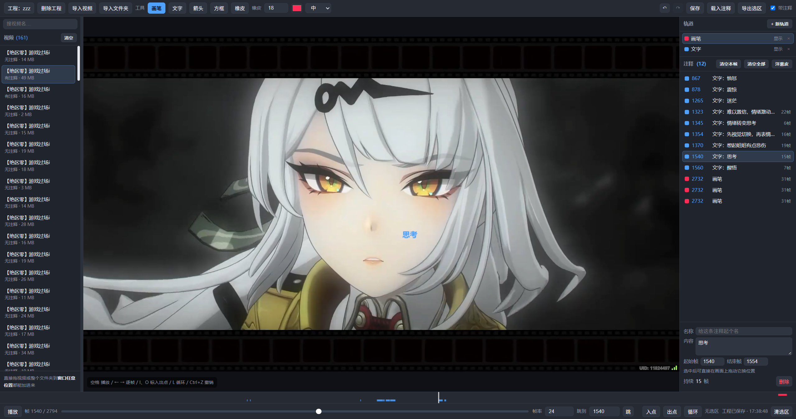

# FrameInk 使用文档

FrameInk 是一款面向个人拉片学习的本地视频标注工具。用户可在视频的任意一帧上绘制图形、添加文字说明，并将该帧或该帧区间标记为一条注释。全部数据保存在本地，不上传，不需要账号。



---

## 1. 系统要求

| 项目 | 要求 |
|---|---|
| 操作系统 | Windows 10 / 11 64 位 |
| 显卡 | 支持硬件解码即可（无特殊要求） |
| 磁盘 | 程序约 440 MB（含 ffmpeg） |
| 运行环境（仅源码运行） | Node.js 20 或以上 |

---

## 2. 安装

FrameInk 提供三种方式，任选其一。

### 2.1 免安装压缩包（推荐）

1. 打开项目的 Releases 页面，下载最新的 `FrameInk-x.y.z-win-x64.zip`。
2. 解压至任意目录。
3. 双击目录内的 `FrameInk.exe` 启动。

压缩包内已包含 ffmpeg，无需另行安装。程序不写入注册表，删除目录即完成卸载。

首次启动时 Windows 可能提示“已保护你的电脑”，点击“更多信息 → 仍要运行”。程序未购买代码签名证书，此提示属正常现象。

### 2.2 安装包

运行 `FrameInk-Setup-x.y.z.exe`，按提示完成安装。安装后可从开始菜单启动。

> 安装包尚未提供，当前请使用压缩包。

### 2.3 命令行运行

适用于已安装 Node.js 20 及以上版本的用户。

```bash
npx github:leonleeyaung/frameink
```

或获取源码后本地运行：

```bash
git clone https://github.com/leonleeyaung/frameink.git
cd frameink
npm install
npm start
```

命令行方式需自行准备 ffmpeg，将 `ffmpeg.exe` 放于项目根目录，或通过环境变量 `LAPIAN_FFMPEG` 指定路径。

---

## 3. 快速上手

1. 启动程序，进入启动页。
2. 点击「新建工程」，填写工程名称并选择工程文件的保存位置。
3. 将视频文件或视频所在文件夹拖入窗口，或使用顶部的「导入视频」「导入文件夹」。
4. 在左侧视频列表中双击任一视频开始观看。
5. 使用方向键或时间轴定位到需要标注的帧。
6. 选择绘图工具，在画面上完成标注。
7. 标注结果自动保存至视频同目录下的注释文件。

---

## 4. 界面说明

程序主界面分为四个区域。

| 区域 | 位置 | 用途 |
|---|---|---|
| 视频列表 | 左侧 | 显示当前工程的视频，支持搜索、重命名、移除 |
| 视频画面 | 中部 | 播放视频，绘制与拖放注释 |
| 轨道与注释列表 | 右侧上部 | 管理轨道，查看并定位注释 |
| 属性面板 | 右侧下部 | 编辑选中注释的名称、文字内容、起止帧 |
| 时间轴与状态栏 | 底部 | 显示选区与时间轴，控制播放、帧率、循环 |

---

## 5. 播放控制

程序在载入视频时自动读取真实帧率，支持 23.976、59.94 等小数帧率，无需手动填写。

| 操作 | 方式 |
|---|---|
| 播放 / 暂停 | 点击「播放」按钮，或按空格 |
| 逐帧前进 / 后退 | 方向键 `←` `→` |
| 跳转到指定帧 | 在「跳到」输入框填写帧号后点击「跳」 |
| 跳转到任意位置 | 拖动底部进度条，或在时间轴上按住拖动 |
| 循环播放选区 | 点击「循环」或按 `L` |

未开启循环时，播放至出点自动停止，并停留在出点所在帧。

---

## 6. 标注工具

工具栏包含六个工具，按 `1` 至 `5` 可快速切换绘图工具，按 `V` 切换至选择工具。

| 工具 | 快捷键 | 说明 |
|---|---|---|
| 选择 | `V` | 选中、拖动已有注释；点击空白处取消选中 |
| 画笔 | `1` | 自由绘制，笔迹按 2.5 像素采样 |
| 文字 | `2` | 在画面上点击后输入文字，边输入边显示，点击其他位置完成 |
| 箭头 | `3` | 拖拽绘制带箭头的直线 |
| 方框 | `4` | 拖拽绘制矩形 |
| 橡皮 | `5` | 按半径擦除笔迹的局部，半径可在工具栏设置或用滚轮调整 |

### 6.1 编辑已有注释

- **移动**：使用选择工具点击注释后拖动，文字、图形、笔迹均可移动。
- **修改文字内容**：选中文字注释后，在属性面板的「内容」栏中直接编辑。
- **修改名称**：在注释列表中双击名称，就地编辑；或选中后在属性面板的「名称」栏修改。
- **删除**：鼠标移至注释列表对应行，点击右侧的 `×`。
- **撤销 / 重做**：`Ctrl+Z` 撤销一步，`Ctrl+Shift+Z` 或 `Ctrl+Y` 重做。每次绘制、移动、删除、修改起止帧均单独计为一步。

---

## 7. 轨道

注释按轨道分类存放，默认包含「画笔」与「文字」两条轨道。切换工具时自动进入对应轨道。

轨道支持以下操作：

| 操作 | 方式 |
|---|---|
| 新增轨道 | 点击「＋ 新轨道」 |
| 切换当前轨道 | 单击轨道行任意位置 |
| 重命名 | 双击轨道名称 |
| 修改颜色 | 点击轨道左侧色块 |
| 显示 / 隐藏 | 点击「显示」/「隐藏」 |
| 删除轨道 | 点击轨道行右侧 `×`，删除前会提示该轨道上的注释数量 |

---

## 8. 洋葱皮

洋葱皮用于参考前后帧的标注内容，按轨道独立开启。

将鼠标移至轨道行，点击「显示」左侧的「洋葱」按钮。按钮变为蓝底表示已开启。

开启后，该轨道在前后两帧上的注释将以半透明形式叠加显示于当前画面。不同轨道可单独开启，互不影响。

> 洋葱皮作用于注释，不作用于视频画面。

---

## 9. 注释与起止帧

每条注释记录起始帧与结束帧。

- 默认情况下，注释仅显示在创建时所在的那一帧。
- 将结束帧设为更大的数值后，该注释在起止帧区间内均会显示，可用于一整段镜头的说明。

注释列表按帧号排序，显示轨道颜色、帧号、名称与持续帧数。单击某条注释可跳转至其起始帧并选中。

注释列表标题右侧提供两个清空操作：

| 按钮 | 作用 |
|---|---|
| 清空本帧 | 清除当前轨道在当前帧的全部注释 |
| 清空全部 | 清除当前视频的全部注释（需确认） |

---

## 10. 选区

时间轴上的两条竖线与两个蓝色方块分别表示入点与出点。

- 拖动方块可调整入点或出点。拖动过程中，时间轴白线与帧号同步更新，视频画面保持不动，松开鼠标后跳转至目标帧。
- 入点不得大于出点，拖动时两者不会互相穿越。
- 选区按视频单独记录。切换到其他视频再返回时，将恢复该视频上次的选区。
- 点击「重置选区」可将选区恢复为整段视频并关闭循环。

播放至出点时停止的精度为 ±1 帧，该限制由播放器内核决定。

---

## 11. 工程

工程文件为 `.frameink.json`，仅记录两项内容：该工程包含的视频清单，以及上次观看的视频。

### 11.1 新建工程

点击「新建工程」，填写工程名称并选择保存位置。工程文件保存在用户指定目录，默认目录为“文档/FrameInk”。

### 11.2 打开工程

启动页列出最近使用的工程，支持搜索。也可点击「打开工程文件…」加载其他位置的工程。

### 11.3 管理工程

| 操作 | 方式 |
|---|---|
| 重命名 | 启动页中点击工程行右侧「改名」，或主界面双击「工程」按钮 |
| 从列表移除 | 启动页中点击工程行右侧 `×`。仅从列表移除，不删除工程文件 |

工程文件仅保存视频路径，不包含注释内容。修改视频列表或切换视频时，工程自动保存。

---

## 12. 视频管理

### 12.1 导入

| 方式 | 说明 |
|---|---|
| 导入视频 | 可多选，追加至当前列表 |
| 导入文件夹 | 递归扫描子目录，导入其中的全部视频 |
| 拖放 | 将视频或文件夹拖至窗口任意位置 |

文件夹扫描会跳过系统目录（如 `$RECYCLE.BIN`），最大深度 8 层，最多 20000 个文件。

### 12.2 列表操作

- **搜索**：在列表上方输入框按文件名或相对路径过滤。
- **重命名**：鼠标移至列表项，点击「改」。该操作会修改磁盘上的实际文件名，并将同名的注释文件一并重命名。正在播放的文件无法重命名。
- **移除**：点击列表项右侧 `×`，仅从列表移除，不删除文件。
- **清空**：点击列表标题栏右侧「清空」，移除列表中的全部视频。

每个列表项下方标注「有注释」或「无注释」，保存注释后自动更新。

---

## 13. 导出

标记入点与出点后，点击「导出选区」生成 MP4 文件。

| 模式   | 处理方式           | 说明             |
| ---- | -------------- | -------------- |
| 不带注释 | ffmpeg 直接截取视频流 | 速度快，画质无损失      |
| 带注释  | 逐帧渲染后合成        | 画面中包含标注内容，耗时较长 |

导出文件默认命名为原文件名加 `_带注释` 后缀。

---

## 14. 快捷键

| 按键 | 功能 |
|---|---|
| `空格` | 播放 / 暂停 |
| `←` `→` | 后退一帧 / 前进一帧 |
| `V` | 选择工具 |
| `1` `2` `3` `4` `5` | 画笔 / 文字 / 箭头 / 方框 / 橡皮 |
| `Esc` | 取消选中 |
| `I` | 标注入点 |
| `O` | 标注出点 |
| `L` | 开启 / 关闭循环 |
| `Ctrl+Z` | 撤销一步 |
| `Ctrl+Shift+Z` 或 `Ctrl+Y` | 重做一步 |

---

## 15. 数据存储

程序涉及三类数据，互相独立。

```
① 工程   用户指定的 .frameink.json 文件
         内容：视频路径清单、上次观看的视频

② 视频   用户原始文件，程序不修改

③ 注释   与视频同目录、同名
         EP01.mp4  →  EP01.拉片注释.json
```

注释随视频保存。迁移、备份或分享时，将视频与其同名的 JSON 文件一并移动即可。若单独重命名视频文件，需同步重命名注释文件。

---

## 16. 常见问题

**依赖安装卡在 Electron 下载**

使用镜像源：

```powershell
$env:ELECTRON_MIRROR="https://npmmirror.com/mirrors/electron/"
$env:npm_config_registry="https://registry.npmmirror.com"
npm install
```

**双击后程序闪退，不显示界面**

若系统中存在环境变量 `ELECTRON_RUN_AS_NODE`，Electron 会以 Node.js 模式运行，导致界面无法启动。清除该变量后重新启动：

```powershell
$env:ELECTRON_RUN_AS_NODE = ""
npm start
```

**导出选区提示「视频路径无效」**

该视频未获取到真实文件路径。请通过「导入视频」或「导入文件夹」导入。

**注释内容未显示**

检查视频同目录下是否存在同名 `.拉片注释.json` 文件。若视频被重命名而注释文件未同步，修改两者名称使其一致。

**关闭窗口后程序仍在后台运行**

关闭窗口仅将程序最小化至系统托盘。如需完全退出，右键点击托盘图标并选择退出。

---

## 17. 已知限制

- 播放停止精度为 ±1 帧，无法做到绝对零误差。
- 导出带注释的视频为逐帧渲染，30 秒片段约需 1 分钟。
- 视频列表不显示缩略图。
- 洋葱皮仅作用于注释，不作用于视频画面。
- 安装包尚未提供。

---

## 18. 许可

MIT
