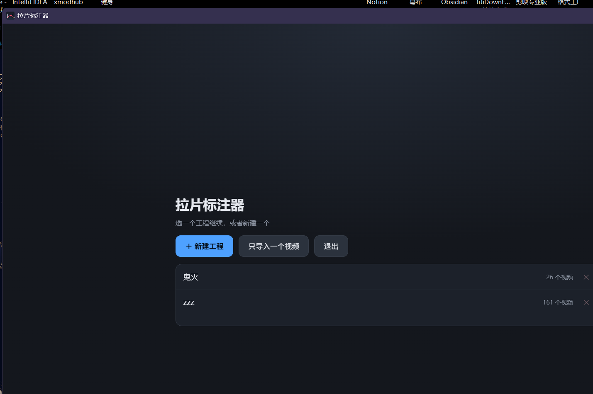

# FrameInk · 帧墨

> A frame-accurate annotation tool for animation study. Load a clip, step through it
> frame by frame, draw or write directly on the picture, keep shot notes, and export
> the marked range as a video — all locally, no upload, no account.

给动画/影视拉片用的本地标注工具：**逐帧看片 → 在画面上画和写 → 镜头笔记 → 导出片段**。

原本是网页版，现在做成了桌面软件（Electron），因为网页拿不到真实文件路径、调不了 ffmpeg、也不能自定义右键菜单。



---

## 它解决什么

拉片的时候，脑子里是这样一件事：

> 这个镜头从第几帧切到第几帧？构图怎么摆的？动作怎么走的？下次拍怎么参考？

拿播放器 + 记事本干这件事，要来回切窗口、手动记时间码、截图画圈还要另开软件。

这个工具把这几步放进一个窗口：**左边是片子，右边是笔记，中间能直接画。**

---

## 功能

### 看片

- **逐帧**（`←` `→`）——按源视频的真实帧率走，自动探测（59.94 这种小数也认）
- **跳帧**：输入帧号直接跳
- **选区循环**：标入点 / 出点，只在这一段里反复播
- **自动停止**：不循环时播到出点自动停

### 标注

| 工具 | 快捷键 | 说明 |
|---|---|---|
| 画笔 | `1` | 自由手绘，笔迹按 2.5px 密集采样 |
| 文字 | `2` | 点画面上直接打字，**边打边上屏**，不用回车确认 |
| 箭头 | `3` | 拖一条带箭头的线 |
| 方框 | `4` | 圈重点 |
| 橡皮 | `5` | **局部擦除**，按半径擦掉笔迹的一段；滚轮可调大小 |

- **拖动改位置**：选中一条注释，直接在画面上拖走
- **撤销 / 前进**：`Ctrl+Z` / `Ctrl+Shift+Z`（或 `Ctrl+Y`）
- **洋葱皮**：显示前后帧的注释淡影，画连续动作时用

### 轨道

- 默认两条：**画笔** 和 **文字** —— 选工具时自动切到对应轨道
- 可以**新增轨道**、**双击改名**、**换颜色**、**单独隐藏**
- 删轨道会提示上面有几条注释

### 注释的生命周期

- 每条注释有**起始帧 / 结束帧**，默认只占 1 帧，可以拉长到一段
- 可以给每条起**名字**（列表里显示的名字）
- 文字注释的内容**随时能改**

### 工程

- **启动页选工程**：新建或打开之前的工程
- 工程只记「有哪些视频」和「上次看到哪个」，**不含注释内容**
- 列表变化、切换视频都会**自动存**，不用点保存
- 左边视频列表：单个移除 / 全部清空（**只从列表移除，不删文件**）

### 导入

- **导入视频**（多选）、**导入文件夹**
- **拖拽**：视频或整个文件夹拖到窗口任意位置
- 文件夹会**递归遍历所有子文件夹**找视频（跳过系统目录，最多 8 层 / 2 万个文件）

### 导出

| 方式 | 速度 | 输出 |
|---|---|---|
| **导出选区（不勾注释）** | 秒级（ffmpeg 直接切流） | MP4 |
| **导出选区 + 勾「带注释」** | 慢（逐帧渲染再合成） | MP4，画面里烤进你画的圈和字 |

---

## 数据放在哪

三层，各管各的：

```
① 工程  C:\Users\<你>\AppData\Roaming\lapian-studio\projects.json
        只记视频清单 + 上次看到哪个

② 视频  原文件，永远不动

③ 注释  跟视频放在一起，同名
        EP01.mp4  →  EP01.拉片注释.json
```

**注释跟着视频走**：换电脑、备份、发给别人，视频和它旁边的 json 一起带走就行。

---

## 使用教程

### 第一次用

1. 双击桌面图标 → 出现**启动页**
2. 点 **＋ 新建工程** → 起个名字
3. 把动画文件夹**直接拖进窗口**

> 也可以跳过工程，直接拖文件夹 —— 会自动建一个叫「放映 xx-xx xx:xx」的工程

### 标一个镜头

```
← →          找到想标的那一帧
1            画笔
在画面上拖    画圈 / 画箭头（换 3 / 4）
2            文字，点一下开始打字，回车或点别处结束
```

### 让标注持续一小段

1. 右边列表点选那条注释
2. 详情面板里改 **结束帧**（比如从 120 改到 128）
3. 这一段里它都会显示

### 只反复看某一段

```
← →        移到起点，按 I（标入点）
← →        移到终点，按 O（标出点）
L          开启循环
空格       播放，就在这段里循环
```

### 导出

1. 标好入点出点
2. 点 **导出选区**
   - 不勾「带注释」→ 几秒出 MP4（切片，不重编码）
   - 勾「带注释」→ 逐帧渲染后合成，慢但画面里带着你的标注

### 快捷键总表

| 键 | 作用 |
|---|---|
| `空格` | 播放 / 暂停 |
| `←` `→` | 逐帧后退 / 前进 |
| `1` `2` `3` `4` `5` | 画笔 / 文字 / 箭头 / 方框 / 橡皮 |
| `I` `O` | 标入点 / 出点 |
| `L` | 循环开 / 关 |
| `Ctrl+Z` | 撤销 |
| `Ctrl+Shift+Z` / `Ctrl+Y` | 前进 |

---

## 安装

### 方式一：下载发布包（推荐，不用装任何东西）

1. 打开右侧 **Releases** 页面
2. 下载 `LapianStudio-x.y.z-win-x64.zip`
3. 解压到任意目录（比如 `D:\tool\Lapian`）
4. 双击 **`拉片标注器.exe`**

> **不用安装**，不写注册表，删掉文件夹就等于卸载。
> 第一次运行 Windows 可能弹「已保护你的电脑」——点 **更多信息 → 仍要运行**。
> 这是因为没买代码签名证书，不是有病毒。

**还需要一个东西：ffmpeg**

看片和标注不需要它，但**导出选区需要**。两种做法：

```
A. 把它放到程序旁边（最简单）
   解压包里放 ffmpeg.exe 在 拉片标注器.exe 同一个目录

B. 设环境变量
   setx LAPIAN_FFMPEG "D:\你的路径\ffmpeg.exe"
```

没装 ffmpeg 也能正常用，只是点「导出选区」会提示失败。

---

### 方式二：从源码跑（开发者）

需要 **Node.js 20+**（推荐 22）。

```bash
git clone <这个仓库>
cd lapian-studio
npm install
npm start
```

国内装 Electron 慢的话，用镜像：

```bash
# Windows PowerShell
$env:ELECTRON_MIRROR="https://npmmirror.com/mirrors/electron/"
$env:npm_config_registry="https://registry.npmmirror.com"
npm install
```

打包成 exe（可选）：

```bash
npm i -D electron-builder
npx electron-builder --win portable
```

### 依赖

- **Electron** —— 桌面外壳
- **ffmpeg** —— 切片和合成。程序会按这个顺序找：
  1. 环境变量 `LAPIAN_FFMPEG` 指定的路径
  2. 同级目录下的 `ffmpeg.exe`
  3. 系统 PATH 里的 `ffmpeg`

没有 ffmpeg 也能用：看片、标注、存注释都不依赖它，**只有导出选区会不可用**。

---

## 常见问题

**装依赖卡住 / Electron 下载失败**

国内直连 npm 和 GitHub 经常断。用镜像：

```powershell
$env:ELECTRON_MIRROR="https://npmmirror.com/mirrors/electron/"
$env:npm_config_registry="https://registry.npmmirror.com"
npm install
```

**双击后黑屏 / 闪一下就没了**

Electron 有个环境变量 `ELECTRON_RUN_AS_NODE`，被设成 `1` 时会让它当普通 Node 跑，界面起不来。

手动启动前先清掉：

```powershell
$env:ELECTRON_RUN_AS_NODE = ""
npm start
```

**导出选区提示「视频路径无效」**

说明这个视频没有真实文件路径。用 **导入视频 / 导入文件夹**，不要用浏览器版拖拽。

**注释丢了**

注释存在视频旁边的同名 `.拉片注释.json`：

```
EP01.mp4   →   EP01.拉片注释.json
```

- 视频改名了 → json 名字也要跟着改
- 视频和 json 一起移动/备份就没问题
- 工程里只有视频路径，**不含注释内容**

---

## 目录结构

```
lapian-studio/
├── main.js              主进程：文件读写、ffmpeg、原生菜单、托盘
├── preload.js           安全桥接（只暴露必要接口）
├── renderer/
│   └── 拉片标注器.html   整个界面（单文件：HTML + CSS + JS）
├── icon.png / icon.ico  图标
└── package.json
```

界面就是一个 HTML 文件，没有框架、没有构建步骤——改完存盘，重启就生效。

---

## 已知限制

- **导出带注释要实时渲染**，30 秒的片段大概要等一分钟左右
- **浏览器版（直接用 Chrome 打开 html）功能不全**：不能导出 MP4、每次要授权文件夹、没有原生右键菜单
- **视频缩略图没有**，列表只显示文件名
- **洋葱皮只作用于注释**，不是视频画面

---

## 许可

MIT
